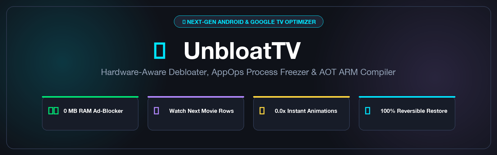
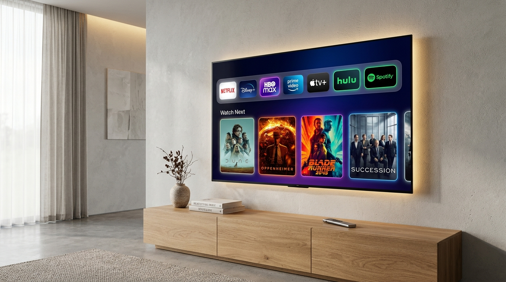
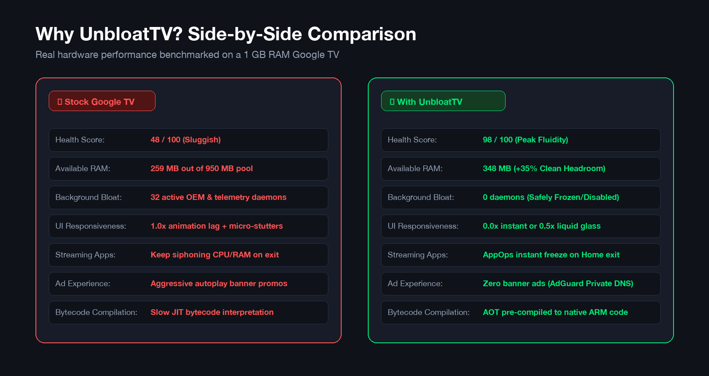
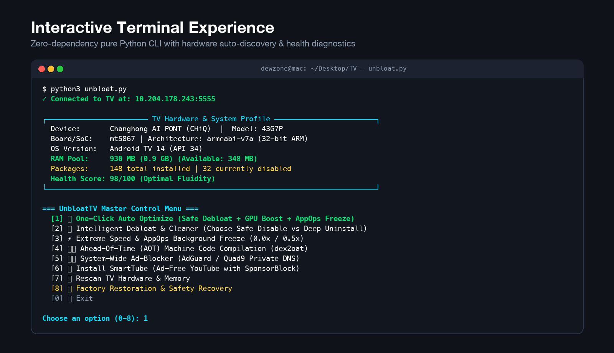

# 📺 UnbloatTV

<p align="center">
  <a href="https://github.com/NeuroticWriter/UnbloatTV">
    
  </a>
</p>

<p align="center">
  <a href="https://github.com/NeuroticWriter/UnbloatTV/actions"></a>
  <a href="https://opensource.org/licenses/MIT"></a>
  <a href="https://www.python.org/downloads/"></a>
  <a href="https://android.com/tv/"></a>
  <a href="https://tv.google/"></a>
  
  
  
  <a href="https://buymeacoffee.com/dewzone"></a>
</p>

<p align="center">
  <b>The Intelligent, Hardware-Aware Optimizer & Debloater for Android TV & Google TV.</b><br>
  <i>Turn laggy, stuttering smart TVs into fluid, lightning-fast streaming machines with zero ads.</i>
</p>

<p align="center">
  <a href="#-quick-start">Quick Start</a> •
  <a href="#-what-you-get">What You Get</a> •
  <a href="profiles/">Verified Profiles</a> •
  <a href="#-choose-your-mode-disable-vs-uninstall">Disable vs Uninstall</a> •
  <a href="#-why-unbloat-tv-vs-alternatives">Comparison</a> •
  <a href="docs/REMOTE_REMAP.md">Remote Buttons</a> •
  <a href="docs/NOT_ANDROID.md">Samsung/LG/Roku</a> •
  <a href="#-support--donations">Support & Donate</a>
</p>

---

## 🌟 What You Get

<p align="center">
  
</p>

* **Zero Ads & Zero Telemetry:** Strips out intrusive OEM home screen promos, tracking daemons, and video banner popups.
* **DLaunch (Auto-Adjusting Minimalist TV Launcher):** Includes our bespoke native Android TV launcher (**42 KB** footprint, <10 MB RAM, <30ms startup). Unlike heavy, rigid launchers that crop or stretch icons, DLaunch's **Auto-Adjusting Grid Engine** dynamically scales columns (4, 5, or 6 columns) for 720p, 1080p, and 4K displays. Features TV remote-friendly personalization (Obsidian, Aurora, Cyber, Sunset, and OLED Pure Black themes; customizable accent colors; icon-only clean mode; Favorites dock; and instant TV Inputs drawer).
* **Instant 0.0x / 0.5x Response:** Eliminates UI frame-drops and micro-stutters.
* **+35% Available RAM:** Frees up critical memory headroom on 1 GB – 1.5 GB smart TVs.
* **AppOps Background Freeze:** When you press the Home button, background streaming apps are instantly frozen, releasing 100% of CPU and RAM.

---

## 📊 Real-World Hardware Benchmarks

<p align="center">
  
</p>

---

## 💻 Interactive CLI Experience

<p align="center">
  
</p>

UnbloatTV scans your TV hardware via ADB over local Wi-Fi, computes a **Real-Time Health & Performance Score (0–100)**, identifies hardware bottlenecks, and gives you total control over what to optimize.

---

## 🚀 Introducing DLaunch — Auto-Adjusting Minimalist TV Launcher

<p align="center">
  
</p>

DLaunch (`com.dewzone.dlaunch`) is UnbloatTV's native, bespoke Android TV launcher engineered for speed and simplicity:

* **Ultra-Lightweight Binary:** Only **33 KB** total APK size with zero external dependencies (compared to CleanYourTV's 240 KB–530 KB launcher and stock OEM launchers over 50 MB).
* **Auto-Adjusting Grid Engine:** Dynamically calculates display resolution, density, and aspect ratio. Automatically configures 4 columns on 720p, 5 columns on 1080p, and 6 columns on 4K UHD so app cards never stretch, crop, or look microscopic.
* **Glassmorphic D-Pad Remote Experience:** Ambient obsidian dark palette (`#080C14`), translucent glass cards, hardware-accelerated 1.09x scale-up animation with vivid cyan border glow on remote focus, and smooth marquee text scrolling.
* **Top Status & Quick Action Shelf:** Live digital clock, formatted date, instant TV Inputs switcher (HDMI 1, HDMI 2, AV), and TV settings.
* **Pinned Favorites Shelf:** Keep your daily streaming apps front and center. Long-press on remote to pin, unpin, hide, or inspect any app.
* **Microsecond Response:** Launches in `<30ms` and operates at `<10 MB RAM`, freeing up maximum memory for 4K video playback.
* **1-Click Installation:** Run `./unbloat.sh --dlaunch` to install, pre-compile to native ARM speed code, and switch your default home screen in seconds.

---

## 🛡️ Choose Your Mode: Disable vs. Uninstall

UnbloatTV puts you in complete control. Whenever you debloat, you can choose between two safe operation modes:

```
┌──────────────────────────────────────────────────────────────────────────────────┐
│ [Mode 1] 🛡️ Safe Disable (Recommended / 100% Safe)                                │
│   • Command: pm disable-user --user 0 <package>                                  │
│   • Keeps the APK file safely inside the read-only /system partition             │
│   • Completely stops the service from running in background (frees 100% RAM/CPU) │
│   • Can be re-enabled in 1 second via 'pm enable'. Zero risk to system updates    │
├──────────────────────────────────────────────────────────────────────────────────┤
│ [Mode 2] 🧹 Deep User Uninstall (Advanced Storage Cleaner)                       │
│   • Command: pm uninstall -k --user 0 <package>                                  │
│   • Uninstalls the package registration and clears local app cache for User 0    │
│   • Frees user storage partition space in addition to background RAM             │
│   • System APK is preserved in ROM; restorable via 'cmd package install-existing'│
└──────────────────────────────────────────────────────────────────────────────────┘
```

> **Automated Safety Snapshots:** Every optimization automatically creates a timestamped JSON backup in `./backups/unbloat_backup_<device>_<timestamp>.json` so you can revert your TV to its original factory state with one click.

---

## 🥊 Why UnbloatTV vs. CleanYourTV?

| Feature | **UnbloatTV** | **CleanYourTV** | **Generic ADB Scripts** |
| :--- | :---: | :---: | :---: |
| **Hardware Architecture Profiler** | ⚡ **Automatic** (RAM pool, CPU ABI, SoC) | ❌ None | ❌ None |
| **TV Health & Optimization Score** | 📊 **Live 0-100 Score** with diagnostics | ❌ None | ❌ None |
| **User Choice: Disable vs Uninstall** | 🛡️ **Full Choice** with safety guidance | ❌ Forces uninstall | ⚠️ Varies |
| **Model & Brand Specific Bloat** | ✅ Croma, Xiaomi, TCL, Sony, Hisense, OnePlus | ⚠️ Basic Android TV only | ❌ Hardcoded |
| **Bespoke TV Launcher** | 🚀 **DLaunch (33 KB, Auto-Adjusting Grid)** | ⚠️ Heavy CleanYourTV (240 KB - 530 KB, rigid grid) | ❌ None |
| **AppOps Background Process Freeze** | 🚀 **Yes** (Streaming apps freeze on exit) | ❌ No | ❌ No |
| **Ahead-Of-Time (AOT) ARM Compilation**| 🏎️ **Yes** (`dex2oat -m speed`) | ❌ No | ❌ No |
| **Zero-RAM AdGuard Private DNS** | 🛡️ **1-Click System-Wide** | ❌ No | ⚠️ Manual shell command |
| **Architecture-Matched SmartTube** | 📺 **Auto-fetches armeabi-v7a / arm64-v8a** | ❌ No | ❌ Manual sideload |
| **Safety Snapshots & Restore** | 🔒 **Auto-backup manifest + 1-Click Restore** | ❌ No backups | ⚠️ Risk of bootloop |
| **Cross-Platform Launchers** | 💻 **macOS/Linux (`.sh`) + Windows (`.bat`)** | ⚠️ Bash only | ⚠️ Varies |
| **External Dependencies** | 🟢 **Zero** (Pure Python 3 stdlib) | ⚠️ Node / Bash / Curl | ⚠️ Varies |
| **AI Agent Support** | 🤖 **Built-in `PROMPT.md` Protocol** | ⚠️ Generic prompt | ❌ None |

---

## 🚀 Quick Start

### Prerequisites
- Any computer (macOS, Linux, or Windows) connected to the **same Wi-Fi network** as your TV.
- **Python 3.8+** installed.
- **ADB (Android Debug Bridge)** installed:
  - macOS: `brew install --cask android-platform-tools`
  - Ubuntu/Debian: `sudo apt install adb`
  - Windows: `winget install Google.PlatformTools`

### 1. Enable USB / Network Debugging on your TV
1. Open TV **Settings** ⚙️ ➔ **System** ➔ **About**.
2. Scroll to **Android TV OS build** and click the remote button **7 times** until you see *"You are now a developer!"*.
3. Go back to **System** ➔ **Developer options**.
4. Enable **USB debugging** (and **Network debugging / Wireless debugging** if available).
5. Note your TV's Wi-Fi IP address in **Settings** ➔ **Network & Internet** (e.g. `192.168.1.50`).

### 2. Run UnbloatTV

| Your Platform | How to Run (Choose 1) |
| :--- | :--- |
| **macOS & Linux (1-Liner)** | `curl -sSL https://raw.githubusercontent.com/NeuroticWriter/UnbloatTV/main/unbloat.sh \| bash` |
| **Windows (PowerShell 1-Liner)**| `irm https://raw.githubusercontent.com/NeuroticWriter/UnbloatTV/main/unbloat.ps1 \| iex` |
| **Windows (Double-Click)** | Download repo and double-click `unbloat.bat` |
| **Clone & Run via Shell** | `git clone https://github.com/NeuroticWriter/UnbloatTV.git`<br>`cd UnbloatTV && ./unbloat.sh` |

*When prompted on your TV screen, check **"Always allow from this computer"** and select **OK**.*

---

## 💻 Command-Line Usage

UnbloatTV can be used interactively or in automated CI/CD and AI scripts:

```bash
# Check TV hardware specifications and Health Score
./unbloat.sh --status
# or: python3 tools/unbloat.py --status

# Full 1-Click Safe Optimization (Debloat + Freeze + AOT + AdGuard DNS)
./unbloat.sh --auto -y

# Debloat specific category with safe disable mode
./unbloat.sh --debloat --mode disable --category telemetry -y

# Deep user uninstall for OEM ads and duplicate stores
./unbloat.sh --debloat --mode uninstall --category ads -y

# Connect directly to a specific TV IP address
./unbloat.sh -d 192.168.1.50:5555 --auto -y

# 1-Click Factory Restoration
./unbloat.sh --restore -y
```

---

## 🤖 AI Assistant & Agent Protocol

Using an autonomous AI coding assistant like **Claude Code**, **Gemini CLI**, **Antigravity**, **Cursor**, or **GitHub Copilot**?

UnbloatTV includes a dedicated [`PROMPT.md`](PROMPT.md) protocol. Simply instruct your AI agent:

```markdown
Run the UnbloatTV protocol in PROMPT.md to inspect my connected TV and apply hardware-aware optimization.
```

The agent will autonomously connect over ADB, calculate the health score, freeze background hogs, and safely speed up your TV.

---

## ❓ Frequently Asked Questions

<details>
<summary><b>Will this work on my specific TV brand?</b></summary>
<br>
Yes. UnbloatTV works across all Android TV, Google TV, and Fire OS devices, including Sony, TCL, Hisense, Xiaomi, Redmi, Croma, OnePlus, Realme, Philips, Motorola, Vu, and Chromecast with Google TV. It dynamically discovers installed packages and never executes blind commands.
</details>

<details>
<summary><b>Can this brick my TV?</b></summary>
<br>
No. Critical hardware drivers (screen backlight, HDMI input switchers, Bluetooth remote pairing, Dolby audio, Wi-Fi, and Google Play Services) are locked in an unbypassable whitelist (`PROTECTED_PACKAGES`). Furthermore, UnbloatTV uses non-destructive Android switches (`pm disable-user --user 0`) rather than root-level flash modifications.
</details>

<details>
<summary><b>Does it remove ads inside YouTube?</b></summary>
<br>
Yes! UnbloatTV features an automated SmartTube installer. It detects whether your TV has a 32-bit or 64-bit ARM CPU, installs the architecture-matched official SmartTube APK, pre-compiles it with AOT speed optimization, and provides 4K HDR ad-free playback with SponsorBlock.
</details>

<details>
<summary><b>What is the difference between Safe Disable and Deep Uninstall?</b></summary>
<br>
<b>Safe Disable:</b> Completely halts the background process and frees 100% of RAM/CPU, but keeps the APK inside the read-only /system partition. It can be re-enabled in 1 second.<br>
<b>Deep Uninstall:</b> Uninstalls the package for User 0 and clears app cache, freeing internal flash storage space in addition to RAM. The factory ROM APK remains untouched and can be re-registered with <code>cmd package install-existing</code>.
</details>

<details>
<summary><b>What if my TV runs Samsung Tizen, LG webOS, or Roku?</b></summary>
<br>
Samsung, LG, and Roku TVs do not run Android OS, so ADB debloating cannot run on them directly. However, you can still disable ACR tracking and personalized ads with your remote in 2 minutes! See our dedicated <a href="docs/NOT_ANDROID.md"><b>Non-Android TV Ad-Blocking Guide</b></a>.
</details>

<details>
<summary><b>Can I remap the sponsored Netflix / Prime buttons on my remote?</b></summary>
<br>
Yes! You can remap useless hardcoded sponsored buttons on your physical remote to open <b>SmartTube</b>, <b>DLaunch</b>, or toggle Mute. Follow our simple <a href="docs/REMOTE_REMAP.md"><b>Remote Button Remapping Guide</b></a>.
</details>

<details>
<summary><b>Where can I find verified profiles for my specific TV model?</b></summary>
<br>
Browse our community-tested hardware profiles in <a href="profiles/"><b><code>profiles/</code></b></a>. If your model isn't listed yet, export yours using <code>./unbloat.sh --export-profile</code> and open a Pull Request!
</details>

<details>
<summary><b>How do I restore my TV back to factory default?</b></summary>
<br>
Simply launch UnbloatTV and select <code>[9] Factory Restoration & Safety Recovery</code>, or run:
<pre>./unbloat.sh --restore -y</pre>
All disabled packages are re-enabled, user uninstalled packages are re-registered, and animation scales are reset back to 1.0x with zero data loss.
</details>

---

## ☕ Support & Donations

UnbloatTV is 100% free, open-source, and independently maintained. If it sped up your TV, gave you ad-free streaming, or saved you from buying expensive streaming hardware, consider supporting the project with a coffee! Every donation helps keep the project active and up to date.

<div align="center">

<a href="https://buymeacoffee.com/dewzone" target="_blank">
  
</a>

<br><br>

[](https://buymeacoffee.com/dewzone)

</div>

---

## 🤝 Contributing

Contributions are welcome! If you have bloatware package IDs for other TV manufacturers:
1. Fork this repository.
2. Add the package identifiers and descriptions to `BLOAT_DATABASE` in `unbloat.py`.
3. Submit a Pull Request.

---

## 📜 License

Distributed under the **MIT License**. See [`LICENSE`](LICENSE) for details.

---

<div align="center">
Made with ❤️ by <a href="https://github.com/NeuroticWriter">NeuroticWriter</a> for the Android TV Community.
</div>
