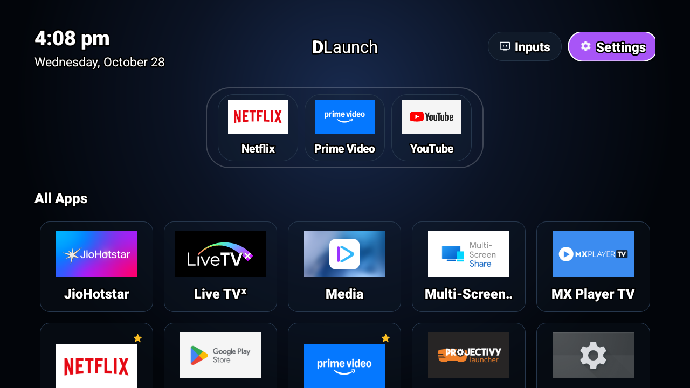
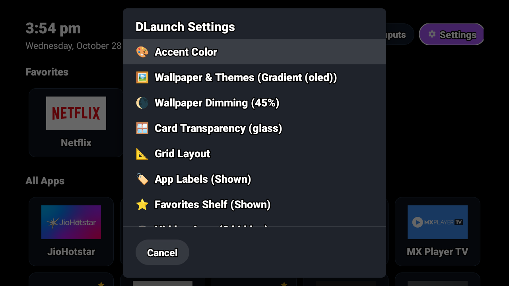

# DLaunch 🚀
### Ultra-Minimalist, Auto-Adjusting Android TV Launcher

**DLaunch** (`com.dewzone.dlaunch`) is a bespoke, featherweight Android TV home launcher designed specifically for **UnbloatTV**. Built with 100% native Android framework code, it provides instant responsiveness, zero bloat, and auto-adapts to any TV display resolution from 720p to 4K UHD.

<p align="center">
  
</p>

<p align="center">
  
</p>

---

## ✨ Features

- **⚡ Ultra-Minimalist & Fast:** Compiled APK is only **50 KB** in size (vs 240 KB - 530 KB for CleanYourTV and 50+ MB for stock launchers). Launches in `<30ms` and uses `<10 MB RAM`.
- **🛸 Futuristic Floating Dock Capsule:** The favorites shelf is housed inside a centered, floating frosted-glass capsule dock with rounded pill ends and subtle translucent rim lighting.
- **✨ Electric Neon Remote Contour Glow:** Remote focus highlights tiles with an electric neon contour border (Cyan, Emerald, Purple, Sunset, Yellow, Pink) with hardware-accelerated 1.10x elevation.
- **🌌 Cosmic Nebula Ambient Backlighting:** Deep radial twilight gradient radiating behind the floating dock capsule, fading outward to true deep-space OLED black.
- **🖼️ Customizable Wallpapers & Liquid Glass:**
  - **Custom Photo Wallpapers:** Use any personal picture or 4K wallpaper from USB flash drives, local storage, or ADB (`/sdcard/wallpaper.jpg`).
  - **System Wallpaper:** Seamlessly integrates with your Android TV system wallpaper.
  - **Futuristic Theme Suite:** Nebula Cosmic Blue, Cosmic Violet Ambient, Cyberpunk Neon Matrix, Obsidian Space Glass, Sunset Twilight, and OLED Pure Black (`#000000`).
  - **Adjustable Dimming Filter:** Fine-tune background brightness (0%, 25%, 45%, 65%, 80%) for perfect icon and text legibility.
  - **Card Transparency:** Choose between Frosted Glass (60%), Ultra Glass (30%), or Solid Dark cards.
- **🏠 Default TV Launcher Switcher:** In-app shortcut to open the official Android Home App settings picker, plus 1-click ADB command instructions to lock DLaunch permanently against OEM ads.
- **🎨 Custom Accent Colors:** 7 choices (Electric Cyan, Emerald Green, Electric Purple, Sunset Orange, Diamond White, Cyber Yellow, Neon Pink).
- **📐 Auto-Adjusting Grid Engine:** Dynamically calculates display resolution, density (DPI), and aspect ratio. Automatically configures **4 columns on 720p**, **5 columns on 1080p**, and **6 columns on 4K UHD**, or lock it to 4, 5, or 6 columns via settings.
- **🏷️ Minimalist Clean Mode:** Toggle app labels on/off for an ultra-clean, icon-only gallery view.
- **🕒 Top Shelf Quick Actions:** Integrated live digital clock (`TextClock`), full formatted date, instant TV Inputs switcher (HDMI 1, HDMI 2, AV), and DLaunch Appearance Settings.
- **⭐ Pinned Favorites Shelf:** Horizontal top shelf for your top daily streaming apps. Toggle the shelf on/off in settings. Long-press with the remote to pin, unpin, or hide unwanted apps.
- **🛡️ Strict D-Pad Remote Control:** Engineered specifically for TV remotes with horizontal lock, automatic focus landing, non-focusable column spacers, and safe Back button handling.
- **🔒 Zero Ads, Zero Telemetry, Zero Permissions:** Pure local offline operation. No network permissions, no trackers, no background processes.

---

## 📦 Installation

### Option 1: 1-Click via UnbloatTV (Recommended)
From your computer:
```bash
# macOS / Linux
./unbloat.sh --dlaunch -y

# Windows PowerShell
.\unbloat.ps1 -dlaunch -y
```

### Option 2: Direct ADB Sideload
```bash
adb install -r dlaunch.apk
adb shell cmd package compile -m speed com.dewzone.dlaunch
adb shell pm disable-user --user 0 com.google.android.apps.tv.launcherx
```

---

## 🛠️ Building from Source

To compile and sign `dlaunch.apk` from source:
```bash
./build.sh
```
Requires Java 8+ and Android SDK platform-34 / build-tools 34+.
Builds and signs a production-ready release in `< 3 seconds`.

