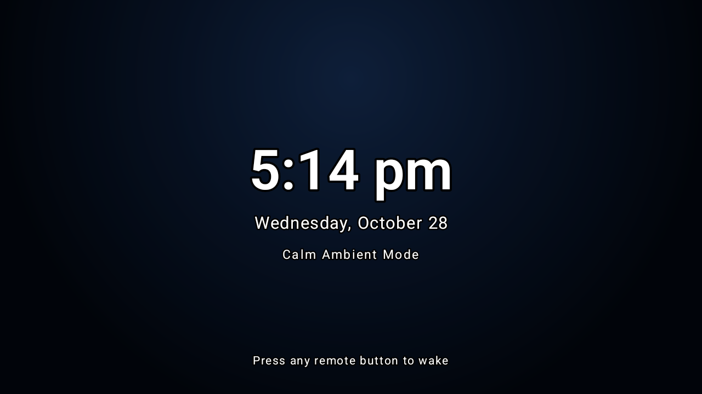

# DLaunch 🚀
### Ultra-Minimalist, Auto-Adjusting Android TV Launcher

**DLaunch** (`com.dewzone.dlaunch`) is a bespoke, featherweight Android TV home launcher designed specifically for **UnbloatTV**. Built with 100% native Android framework code, it provides instant responsiveness, zero bloat, and auto-adapts to any TV display resolution from 720p to 4K UHD.

<p align="center">
  
</p>

<p align="center">
  
</p>

<p align="center">
  
</p>

---

## ✨ Features

- **⚡ Ultra-Minimalist & Fast:** Compiled APK is only **63 KB** in size (vs 240 KB - 530 KB for CleanYourTV and 50+ MB for stock launchers). Cold-launches in `<30ms` and uses `<10 MB RAM`.
- **🛸 Pure Squircle Dock Capsule:** The top favorites dock capsule houses pure squircle icon cards (76x76dp, 18dp squircle radius) without text clutter, matching high-end futuristic TV UI design.
- **🌊 Liquid Glass Action Pills:** The "Inputs" and "Settings" header buttons feature translucent liquid glass gradients (`#331E2D44` to `#44101A29`) with zero-clipping rounded pill boundaries and glowing neon contour strokes on remote focus.
- **🌙 Calm Ambient Screensaver:** Built-in idle screensaver (1m, 2m, 3m, 5m, 10m, or manual preview) that smoothly fades the UI to reveal an elegant, floating ambient clock (`76sp` glowing typography), date, and tranquil liquid backlighting. Any remote keypress instantly wakes the launcher without accidental app launches.
- **🪟 Futuristic TV Glass Settings Panel:** Replaces bland system alert dialogs with a custom 24dp frosted liquid glass modal featuring glowing squircle category icons, informative subtitle descriptions, and live status badges (`[Active Default]`, `[Liquid Ocean]`, `[3 min]`, `[45%]`).
- **✨ Electric Neon Remote Contour Glow:** Remote focus highlights cards and pills with a vibrant 2.5–3dp electric neon contour border (Cyan, Emerald, Purple, Sunset, Yellow, Pink) with hardware-accelerated elevation and smooth scaling.
- **🌌 Liquid Gradient Theme Suite:**
  - **Liquid Ocean:** Calm deep sapphire abyss with top-center radial illumination (Futuristic Default).
  - **Liquid Nebula:** Cosmic twilight indigo & obsidian calm.
  - **Liquid Aurora:** Serene teal & boreal emerald abyss.
  - **Liquid Sunset:** Peaceful dusk horizon with deep amethyst.
  - **Liquid Obsidian:** Sleek obsidian slate with glass depth.
  - **True Black OLED:** Pure `#000000` for zero OLED backlight bleed.
  - **Custom Photo Wallpapers:** Load personal pictures or 4K photos from USB flash drives or `/sdcard/wallpaper.jpg`.
  - **System Wallpaper:** Integrate seamlessly with the TV system wallpaper.
- **🌘 Adjustable Dimming Filter:** Fine-tune background brightness (0%, 25%, 45%, 65%, 80%) for perfect icon legibility.
- **🏠 1-Click Default TV Launcher Setup:** Direct in-app shortcut to open Android TV's official Default Home App settings, plus 1-click ADB command instructions to lock DLaunch permanently against OEM ads.
- **📐 Auto-Adjusting Grid Engine:** Dynamically calculates display resolution, density (DPI), and aspect ratio. Automatically configures **4 columns on 720p**, **5 columns on 1080p**, and **6 columns on 4K UHD**, or lock it to 4, 5, 6, or 7 columns via settings.
- **🕒 Top Shelf Quick Actions:** Integrated live digital clock (`TextClock`), full formatted date, instant TV Inputs switcher (HDMI 1, HDMI 2, AV), and DLaunch Appearance Settings.
- **⭐ Pinned Favorites Shelf:** Pure squircle top capsule for daily streaming apps. Long-press with the remote to pin, unpin, or hide unwanted apps.
- **🛡️ Strict D-Pad Remote Navigation:** Engineered specifically for TV remotes with horizontal lock, automatic focus landing, non-focusable column spacers, and safe Back button handling.
- **🔒 Zero Ads, Zero Telemetry, Zero Permissions:** Pure local offline operation. No network permissions, no trackers, zero background CPU drain.

---

## 📦 Installation

### Option 1: 1-Click via UnbloatTV (Recommended)
From your computer:
```bash
# macOS / Linux
./unbloat.sh --dlaunch -y

# Windows PowerShell
.\unbloat.ps1 -dlaunch -y
```

### Option 2: Direct ADB Sideload
```bash
adb install -r dlaunch.apk
adb shell cmd package compile -m speed com.dewzone.dlaunch
adb shell pm disable-user --user 0 com.google.android.apps.tv.launcherx
```

---

## 🛠️ Building from Source

To compile and sign `dlaunch.apk` from source:
```bash
./build.sh
```
Requires Java 8+ and Android SDK platform-34 / build-tools 34+.
Builds and signs a production-ready release in `< 3 seconds`.
